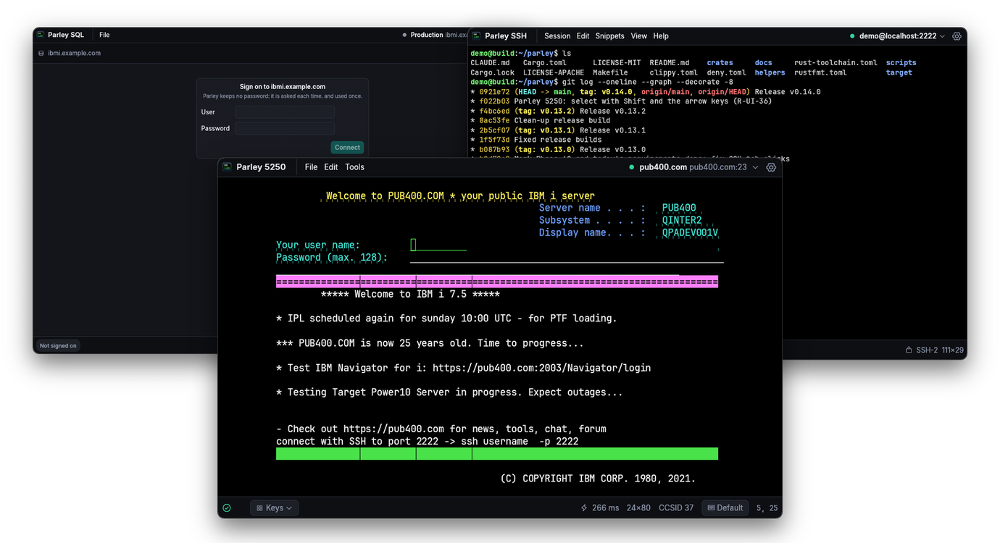

# Parley

**Fast, native desktop tools for IBM i and the servers around it**, for Windows, macOS and Linux, written in Rust.
One download holds three programs:

- **Parley 5250**: a TN5250 terminal emulator for the IBM i green screen.
- **Parley SQL**: SQL for IBM i, with the IBM i habits built in.
- **Parley SSH**: a modern SSH client with tabs and split panes.



No Java runtime is needed for the terminal or the SSH client, nothing to configure on the IBM i, and no password is ever
kept on your computer.

[**Download the latest release**](https://github.com/sorensenNiels/parley/releases/latest) · [Get started](#get-started) · [Documentation](#documentation)

> **Status:** early, before 1.0, and moving fast. A feature counts as done only once it has been checked in the
> running app against a real IBM i or SSH server; see [what is verified](docs/FEATURES.md). Feedback and bug reports are welcome in
> [Issues](https://github.com/sorensenNiels/parley/issues).

## The three programs

### Parley 5250: the terminal

A 5250 emulator that starts at once and is easy to work in all day.

- Telnet or **TLS** (port 992 is the default for new sessions), with certificates checked against the system's trust store
  and an optional company CA file.
- 24×80 and 27×132 screens in colour, scalable, with copy and paste, find, and Shift+arrow selection.
- The keys people know: Enter, Field Exit, Reset, Attention, F1–F24, Page Up/Down, plus your own **keyboard maps**.
- Saved sessions, session groups, several sessions as tabs or windows, and a colour per session.
- **Macros**: record the steps once, saved as plain text files, and run them again.
- EBCDIC code pages 37, 273, 277, 285, 297, 500, 871 and their euro variants.

### Parley SQL: SQL for IBM i

Run SQL Scripts, rethought: one native window for writing SQL, reading the results and finding your way around the
database. Open it on its own (`parley-sql`) or from a 5250 session (**Tools ▸ SQL…**).

- An editor in colour with scripts in tabs and files, formatting, find and replace, and completion of tables and columns.
- Results in tabs: filter, row detail, column headings from `LABEL ON`, hex, compare two results, charts, and Copy as
  JSON, Markdown or `INSERT` statements.
- A schema browser with DDL, plus IBM i tools: `CL:` commands, the job log, message help and the library list.
- Snippets with placeholders, and starters for IBM i Services.
- Downloads to CSV and Excel, and CSV uploads into a table.
- Safe by default: commit control, and a warning before an `UPDATE` or `DELETE` without `WHERE`.
- An optional **assistant** that writes SQL from plain words. It sends table and column names only, never data. It
  works with Anthropic, OpenAI, Gemini, Mistral or a local llama.cpp, and is off until you turn it on.

Parley SQL talks to the IBM i through IBM's own JTOpen driver, so it needs **Java 11 or later** on your computer.

### Parley SSH: the SSH client

An SSH client designed to match today's terminals, not PuTTY.

- An xterm-compatible terminal: colours, the mouse in vim, tmux and htop, and find in the scrollback.
- Tabs and **split panes**, a command palette, and reconnect and restore of last time's tabs.
- The hosts in your `~/.ssh/config` and jump hosts (`ProxyJump`); key files (OpenSSH and PuTTY `.ppk`) and the SSH agent.
- Host keys are always checked, and Parley SSH reads OpenSSH's `known_hosts` too. A changed host key is never accepted
  with one click.
- Snippets and broadcast typing to several sessions at once, and session logs.

## Get started

Download the installer for your system from the [latest release](https://github.com/sorensenNiels/parley/releases/latest).
Every installer holds all three programs.

### Windows

1. Download the `.msi` and run it.
2. **Parley 5250**, **Parley SQL** and **Parley SSH** are now in the Start menu.
3. To use the commands in a terminal, open a **new** terminal window; the installer added them to the PATH.

The installer is not signed yet. If SmartScreen warns you, choose **More info → Run anyway**.

### macOS

1. Download the `.dmg` for your Mac (Apple silicon or Intel), open it and drag **Parley 5250** to Applications.
2. The first time you open the app, macOS says it cannot verify the developer, because the app is not signed yet.
   Right-click the app and choose **Open**. On recent macOS versions, open **System Settings ▸ Privacy & Security** and
   choose **Open Anyway** instead.
3. Parley SQL and Parley SSH are inside the same app. Start them from Parley 5250's **Tools** menu, or link the
   commands into your terminal once:

   ```sh
   for c in parley parley-sql parley-ssh; do
     sudo ln -s "/Applications/Parley 5250.app/Contents/MacOS/$c" /usr/local/bin/$c
   done
   ```

### Linux

**Debian, Ubuntu and derivatives**: install the `.deb`:

```sh
sudo apt install ./parley_*_amd64.deb
```

All three programs are in the application menu, and `parley`, `parley-sql` and `parley-ssh` work in a terminal.

**Any other distribution**: use the `.AppImage`. It runs on glibc 2.35 or newer, which means Ubuntu 22.04 or a later
distribution of the same age.

```sh
chmod +x parley_*_x86_64.AppImage
./parley_*_x86_64.AppImage            # Parley 5250; add --sql or --ssh for the others
```

To have all three commands, link the AppImage once under each name:

```sh
for c in parley parley-sql parley-ssh; do ln -s ~/Apps/parley_*_x86_64.AppImage ~/.local/bin/$c; done
```

Under WSL2 on Windows the apps run through WSLg.

### Java, for Parley SQL only

Parley SQL needs Java 11 or later. If none is found, Parley SQL explains what to install. Any of these will do:

| OS | Install |
|---|---|
| Windows | `winget install EclipseAdoptium.Temurin.21.JRE` |
| macOS | `brew install --cask temurin` |
| Debian, Ubuntu | `sudo apt install default-jre` |

### Your first connection

- **5250**: start Parley 5250, choose **New session…**, enter the host and connect. You sign on on the IBM i's
  own sign-on screen. If you don't have an IBM i at hand, [PUB400.COM](https://pub400.com) is a free public one.
- **SQL**: start Parley SQL, choose **New connection…**, enter the host, then your user and password. Parley asks for
  the password each time and keeps nothing.
- **SSH**: start Parley SSH and type `user@host` in **Quick connect**, or pick one of the hosts from your
  `~/.ssh/config`.

The same from a terminal:

```sh
parley                      # Parley 5250: saved sessions and the connection form
parley ibmi.example.com     # connect at once (port 23); --tls for port 992
parley-sql                  # Parley SQL with its saved connections (also: parley --sql)
parley-sql Production       # sign on to the saved connection "Production"
parley-ssh                  # Parley SSH (also: parley --ssh)
parley-ssh user@host        # connect at once, as ssh does; -p, -l, -i and -J too
```

In Parley 5250, Enter is Enter, Shift+Enter is Field Exit, a Ctrl key on its own is Reset, Esc is Attention, Page Up/Down
roll, and Shift+F1–F12 are F13–F24. The **Keys** button in the status bar lists them all.

## Documentation

| Document | What it holds |
|---|---|
| [docs/PRD.md](docs/PRD.md) | What Parley 5250 is, for whom and why; scope, principles and the release plan. |
| [docs/sql/PRD.md](docs/sql/PRD.md) | The same for Parley SQL. |
| [docs/ARCHITECTURE.md](docs/ARCHITECTURE.md) | How it is built, with diagrams: the crates, one connection at run time, sign-on, macros, testing. |
| [docs/ROADMAP.md](docs/ROADMAP.md) · [SQL](docs/sql/ROADMAP.md) · [SSH](docs/ssh/ROADMAP.md) | The plans: open requirements and the decisions behind the design. |
| [docs/FEATURES.md](docs/FEATURES.md) · [docs/REQUIREMENTS.md](docs/REQUIREMENTS.md) | What is done and how it was verified (the same files under [docs/sql/](docs/sql/) and [docs/ssh/](docs/ssh/)). |
| [docs/IDEAS.md](docs/IDEAS.md) | Ideas that may become requirements. |
| [docs/RELEASING.md](docs/RELEASING.md) | How releases and installers are made. |

## Building from source

```sh
make setup    # once per machine: system libraries, Rust toolchain, cargo tools
make run      # Parley 5250 (make run-sql, make run-ssh for the others)
make verify   # everything CI checks: format, clippy, tests, cargo-deny, the SQL helper
make package  # installers for this OS in target/packages/
```

`make` on its own lists every task. On Windows, `make setup` runs `scripts/setup-windows.ps1` (MSVC build tools,
GNU make, rustup). Under WSL2 the app needs WSLg; `make run` selects the GPU driver for it. Building the SQL helper
needs a JDK 11+.

| Crate | Purpose |
|---|---|
| `crates/parley-core` | The TN5250 engine: telnet negotiation, the 5250 data stream, EBCDIC, the screen model, and the TCP/TLS connection. No UI code. |
| `crates/parley-sql-core` | Parley SQL's engine: the IBM i host servers, the SQL helper's protocol, SQL text, transfers and the assistant. No UI code. |
| `crates/parley-ssh-core` | Parley SSH's engine: the SSH client (russh), host keys and the xterm terminal emulation. No UI code. |
| `crates/parley-ui-egui` | Parley 5250's user interface, built with [egui](https://github.com/emilk/egui), and the look all three share. |
| `crates/parley-sql-ui` | Parley SQL's user interface. |
| `crates/parley-ssh-ui` | Parley SSH's user interface. |
| `crates/parley-app` | The `parley`, `parley-sql` and `parley-ssh` binaries: open the window and run the UI. |

Releases are made with `make release-patch` (or `-minor`, `-major`); see [docs/RELEASING.md](docs/RELEASING.md). The
install notes at the top of every release are [.github/release-install.md](.github/release-install.md).

**Editor:** in VS Code, open the folder and install the recommended extensions (rust-analyzer, Even Better TOML,
CodeLLDB, EditorConfig). Format on save and clippy checks are configured in `.vscode/settings.json`, and
`.vscode/launch.json` debugs the app and the engine tests.

## Name

Parley 5250 was called Parley until 2026-11-16. The command `parley`, the repository and the settings folder keep
that name.

## License

Licensed under either of [Apache License 2.0](LICENSE-APACHE) or [MIT](LICENSE-MIT), at your option.

Parley includes the fonts Inter, JetBrains Mono and IBM Plex Mono, each under the SIL Open Font License 1.1, and
the Phosphor icon font under the MIT licence (`crates/parley-ui-egui/assets/fonts/*-LICENSE.txt`; the installers
carry these files).

Parley SQL ships IBM's JTOpen (`jt400.jar`, unmodified) under the IBM Public License 1.0: Copyright © 1997-2026,
International Business Machines Corporation and others. All Rights Reserved. Its source is at
[github.com/IBM/JTOpen](https://github.com/IBM/JTOpen); see `helpers/sql/NOTICE.txt` and `helpers/sql/JTOpen-LICENSE.html`.
