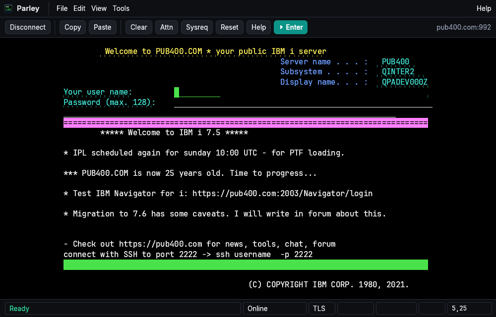

# Parley

A TN5250 terminal emulator for IBM i, written in Rust, for Windows, Linux and macOS.

> **Status:** early development. Parley connects to an IBM i over telnet or TLS, shows the 5250 screen in colour and
> takes input in its fields. It has been checked against a real IBM i up to the sign-on screen; see
> [docs/FEATURES.md](docs/FEATURES.md) for what is verified and [docs/ROADMAP.md](docs/ROADMAP.md) for the plan.



## Documentation

| Document | What it holds |
|---|---|
| [docs/PRD.md](docs/PRD.md) | What Parley is, for whom and why; scope, principles and the release plan. |
| [docs/ARCHITECTURE.md](docs/ARCHITECTURE.md) | How it is built, with diagrams: the crates, one connection at run time, sign-on, macros, testing. |
| [docs/ROADMAP.md](docs/ROADMAP.md) | The plan: open requirements and the decisions behind the design. |
| [docs/FEATURES.md](docs/FEATURES.md) · [docs/REQUIREMENTS.md](docs/REQUIREMENTS.md) | What is done and how it was verified. |
| [docs/IDEAS.md](docs/IDEAS.md) | Ideas that may become requirements. |
| [docs/RELEASING.md](docs/RELEASING.md) | How releases and installers are made. |

## Using it

```sh
parley                      # the connection form: host, port, TLS, code page, screen size, device name
parley ibmi.example.com     # connect at once (port 23); --tls for port 992
```

The last settings are remembered. Keys: Enter is Enter, Shift+Enter is Field Exit, a Ctrl key on its own is Reset,
Esc is Attention, Page Up/Down roll, Shift+F1–F12 are F13–F24; the **Keys** button lists them all.

## Getting started

```sh
make setup    # once per machine: system libraries, Rust toolchain, cargo tools
make run      # start the desktop app
make verify   # everything CI checks: format, clippy, tests, cargo-deny
```

`make` on its own lists every task. On Windows, `make setup` runs `scripts/setup-windows.ps1` (MSVC build tools,
GNU make, rustup). Under WSL2 the app needs WSLg; `make run` selects the GPU driver for it.

## Layout

| Crate | Purpose |
|---|---|
| `crates/parley-core` | The TN5250 engine: telnet negotiation, the 5250 data stream, EBCDIC, the screen model, and the TCP/TLS connection. No UI code. |
| `crates/parley-ui-egui` | The user interface, built with [egui](https://github.com/emilk/egui). |
| `crates/parley-app` | The `parley` binary: opens the window and runs the UI. |

## Releases

Installers for Windows, macOS and Linux are attached to each [GitHub release](https://github.com/sorensenNiels/parley/releases).
`make release-patch` (or `-minor`, `-major`) makes one; see [docs/RELEASING.md](docs/RELEASING.md).

## Editor

VS Code: open the folder and install the recommended extensions (rust-analyzer, Even Better TOML, CodeLLDB,
EditorConfig). Format on save and clippy checks are configured in `.vscode/settings.json`; `.vscode/launch.json`
debugs the app and the engine tests.

## License

Licensed under either of [Apache License 2.0](LICENSE-APACHE) or [MIT](LICENSE-MIT), at your option.

Parley includes the fonts Inter, JetBrains Mono and IBM Plex Mono, each under the SIL Open Font License 1.1
(`crates/parley-ui-egui/assets/fonts/*-LICENSE.txt`; the installers carry these files).
