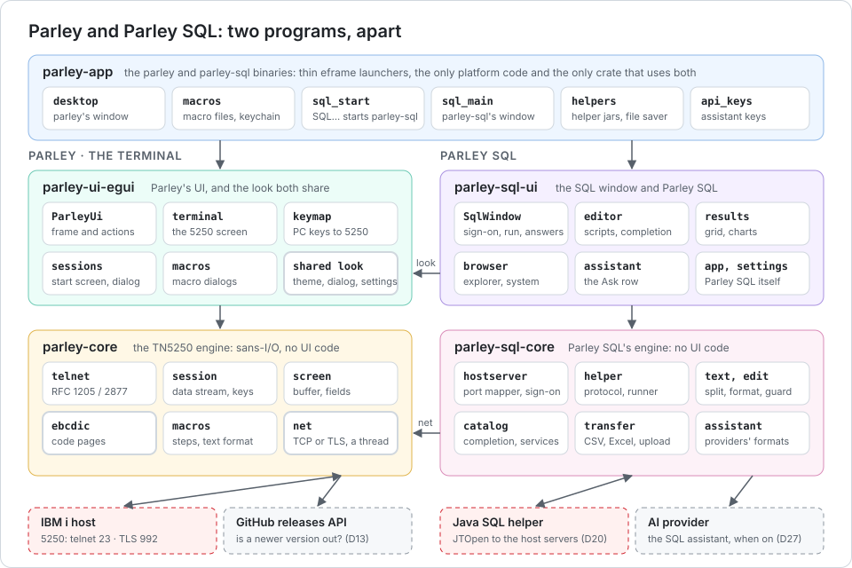
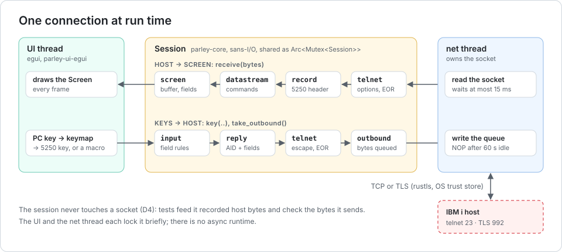

# Parley 5250 architecture

> How Parley is built, with pictures. The why behind each choice is a decision in [DECISIONS.md](DECISIONS.md) (D1–D18) or
> [sql/DECISIONS.md](sql/DECISIONS.md) (D19–D35, the SQL window; D36 splits the crates) or
> [ssh/DECISIONS.md](ssh/DECISIONS.md) (D41–D51, Parley SSH); the
> product view is [PRD.md](PRD.md) and [sql/PRD.md](sql/PRD.md).

## Crates

| Crate | Holds | Never holds |
|---|---|---|
| `parley-core` | The TN5250 engine: telnet negotiation, 5250 records, the data stream, the screen model, EBCDIC, the macro format, the TCP/TLS connection thread (`net::open_stream`, also Parley SQL's), the version check. | UI code; printing; anything of Parley SQL's. |
| `parley-sql-core` | Parley SQL's engine (D20, D36): the IBM i host servers and port mapper, the Java helper's protocol and process, SQL text (split, colour, format, guard), completion, catalog and services queries, downloads and uploads, the SQL assistant's providers. Uses `parley-core` only to connect, for code pages and `Password`. | UI code; printing. |
| `parley-ui-egui` | Parley's UI in egui: the 5250 screen widget, keyboard map, menus, status bar, session, settings and macro dialogs; sessions as tabs and session groups (Phase 40). Also the look Parley SQL shares (D12): `theme`, `dialog`, `icons`, `fonts`, the header (`menu`), the settings frame, Appearance and About (`settings::{layout, appearance, about}`). Reaches the macro folder through a trait (`MacroStore`), so tests use memory. | Platform code; anything of Parley SQL's (`cargo deny` checks, R-P-5). |
| `parley-sql-ui` | Parley SQL's UI: the SQL window (editor, results, side panel, assistant, transfers) and the program around it (`app`: saved connections, header, status bar), with its own `Settings` and settings pages. | Platform code; Parley's terminal. |
| `parley-ssh-core` | Parley SSH's engine (D41–D43): the xterm emulation, sans-I/O over `vte` (bytes in, a screen of cells out); keys, paste and mouse as bytes; known hosts; OpenSSH's `~/.ssh/config` (read-only); the SSH connection with russh on a thread of its own (sign-on, key files, the agent). | UI code; any other Parley crate (R-SSH-1). |
| `parley-ssh-ui` | Parley SSH's UI on `parley-ui-egui`'s look: the terminal widget, sessions and their dialogs, the start screen with saved sessions and `~/.ssh/config` hosts, tabs and split panes (D47), settings. | Platform code; Parley 5250's and Parley SQL's engines. |
| `parley-app` | The `parley`, `parley-sql` and `parley-ssh` binaries: windows, command lines, the macro and snippet folders, the SQL helper's jars, the keychain, `--screenshot`, and starting Parley SQL from Parley (`sql_start`, R-SQL-70). | Protocol logic. |

## One connection at run time

- **`Session` is sans-I/O (D4).** `receive(bytes)` takes what the host sent; keys go in through `key(..)`;
  `take_outbound()` hands back the bytes to send. It never touches a socket or a clock, so a test is a list of bytes
  in and the exact bytes expected out.
- **The net thread** (`parley_core::net`) owns the socket. It reads with a 15 ms time-out, feeds the session, writes
  what the session queued, and sends a telnet NOP after 60 s idle when keep-alive is on (R-NET-5). TLS is rustls with
  the operating system's trust store (D6).
- **The UI thread** locks the session to draw the screen and to pass keys from the keyboard map, or from a macro
  being played (`session/playback`).
- `PARLEY_TRACE=file` appends the inbound bytes as hex, for building test fixtures. Outbound data is never traced:
  it holds what the user typed.

## Host to screen

1. **telnet** — option negotiation (terminal type, binary, end-of-record, NEW-ENVIRON for device name and code
   page) and splitting the stream into records at IAC EOR (RFC 1205, RFC 2877, RFC 4777).
2. **record** — the 5250 record header: opcode and flags.
3. **datastream** — commands (Write To Display, Read MDT Fields, Save/Restore Screen, Write Error Code, Query, …)
   and orders (Set Buffer Address, Start of Field, Repeat to Address, …), cited against IBM's 5250 Functions
   Reference (SC30-3533).
4. **screen** — the character buffer, attributes, format table (fields), cursor and operator information.

## Keys to host

1. **keymap** (UI) turns a PC key into a 5250 key or a Parley action, with the keyboard map of the session (the
   built-in Default map is R-KEY-1; the operator's own maps, kept with the settings, are R-KEY-2).
2. **input** applies the field rules: input-capable, numeric only, monocase, field exit required, auto enter.
3. **reply** builds the answer for an AID key: cursor address, AID code and the modified fields.
4. **telnet** escapes IAC bytes and adds EOR; the bytes wait in the outbound queue for the net thread.

## Sign-on and secrets

- **Parley never signs on by itself and keeps no password** (R-NET-7, D16): the operator signs on on the host's
  screen. NEW-ENVIRON carries the device name and code page, never a user or password, even when the host offers a
  seed for an RFC 4777 password substitute.
- A macro's `password` step asks for the password each time; `Password` has a `Debug` that hides it, and it lives
  only until it is typed.
- Passwords Parley 0.2 saved in the OS keychain are deleted at the first start (`parley-app/src/keychain.rs`).

## Macros

A macro is a text file, one step per line (`text "…"`, key names such as `enter` or `f3`, `wait`, `password`,
`move ROW COLUMN`), in the `macros` folder beside the settings (D14). Recording leaves out passwords (a `password`
step asks for it when played) and refused keys; playing waits for the host to unlock the keyboard after each AID key
and stops at an operator error, Reset or Esc (R-KEY-3, R-KEY-4).

## Testing

- Unit tests next to the code; whole-session tests in `crates/parley-core/tests` with recorded or hand-built
  records — never a live IBM i in `cargo test`.
- UI tests with `egui_kittest`, including a test per dialog that its buttons stay in place.
- `make verify` runs format, clippy (pedantic), all tests and `cargo deny`, as CI does.
- By hand: `make probe HOST=pub400.com` drives a real host without the UI; the running app is checked on each OS
  before a requirement counts as done ([FEATURES.md](FEATURES.md)).

## Regenerating the pictures

The diagrams in `docs/images/*.svg` are hand-written SVG; edit them as text and check them with
`resvg --use-fonts-dir crates/parley-ui-egui/assets/fonts docs/images/runtime.svg target/runtime.png`.
The screenshots come from `parley --screenshot FILE` (a PPM; convert it to PNG) run with a throwaway data folder
(`XDG_DATA_HOME=…` on Linux) so no real sessions show.
