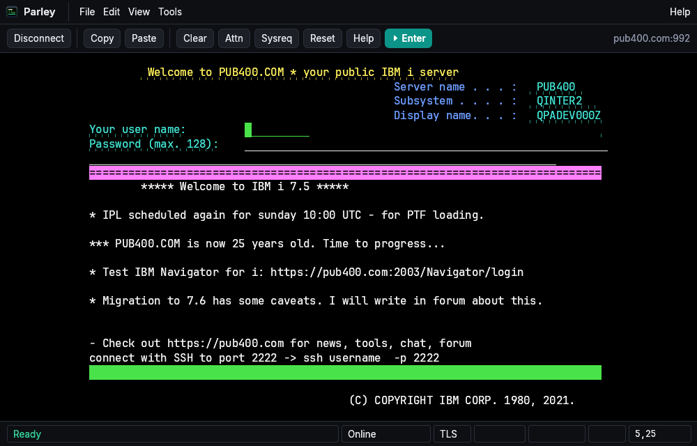
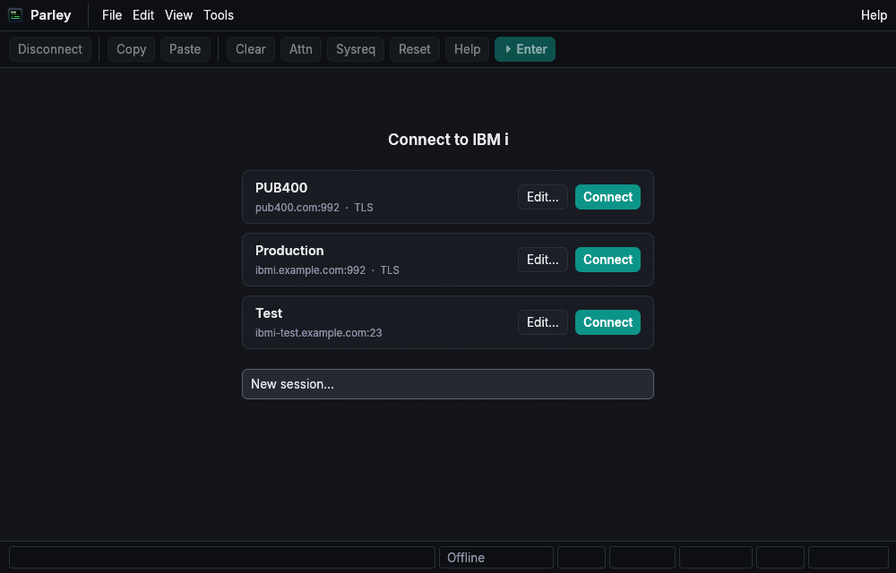
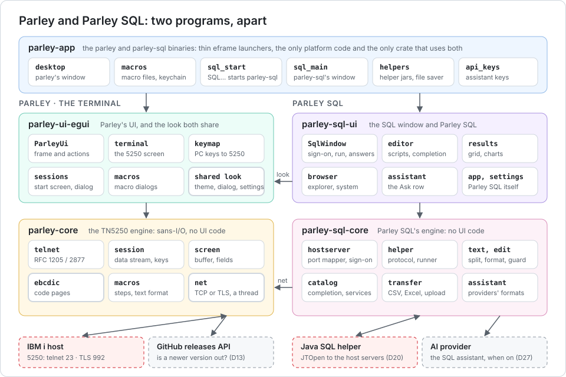
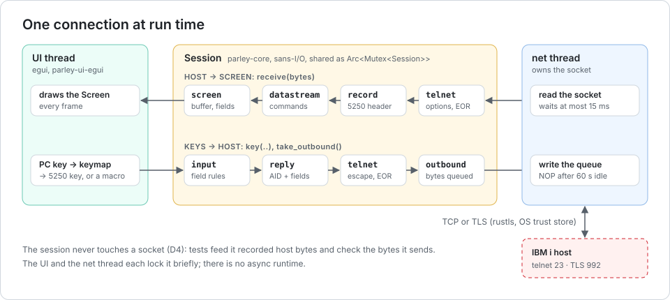
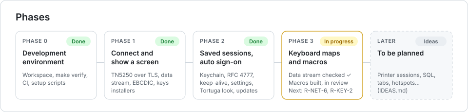

# Parley — product requirements

> What Parley is, who it is for and why, in one place. It summarises the plan; it does not replace it.
> The detailed, binding text is in [ROADMAP.md](ROADMAP.md) (open requirements and decisions) and
> [REQUIREMENTS.md](REQUIREMENTS.md) (done ones), and [FEATURES.md](FEATURES.md) says how each was verified.
> Requirement IDs (`R-NET-7`) and decisions (`D16`) below point there. SQL on IBM i (Parley's SQL add-on and the
> program Parley SQL) has a summary of its own: [sql/PRD.md](sql/PRD.md).

**Status:** draft, written 2026-11-12 from the state after Phase 2 (release 0.2.1) with Phase 3 under way.

## 1. Summary

Parley is a TN5250 terminal emulator for IBM i: a desktop app for Windows, macOS and Linux, written in Rust. It
connects to an IBM i over telnet or TLS, shows the 5250 "green screen" and sends what the user types, as IBM's own
emulators do. It aims to be fast, small and correct, with a modern take on everything around the screen: saved
sessions, keyboard maps, macros and, as an add-on, SQL against the host ([sql/PRD.md](sql/PRD.md)) — and no password
kept on the computer.

## 2. Problem

People who run and develop on IBM i spend much of their day in 5250 sessions. The emulators they use today are:

- **heavy** — large Java applications that are slow to start and look out of place on a modern desktop;
- **dated** — little care for keyboard-first work, copy and paste, or automation beyond what was there decades ago;
- **unclear about security** — plain telnet by default, passwords saved in settings files, "ignore certificate"
  switches.

Parley answers with one native app that starts at once, is secure by default and is built to IBM's specification and
tested against recorded host traffic.

## 3. Users

| Who | What they need |
|---|---|
| **Operators and business users** | Sign on fast, work all day from the keyboard with the keys they know, never lose what they typed. |
| **IBM i developers and administrators** | Several systems (production, test), sessions saved per system, wide 27×132 screens, macros for repeated steps, SQL against the same host (the SQL add-on, [sql/PRD.md](sql/PRD.md)). |
| **Support and new users** | An emulator that installs without a Java runtime, explains connection and sign-on errors in words, and can import settings from the emulator they used before (IDEA-17). |

## 4. Goals and non-goals

**Goals**

1. A correct 5250 session: everything an IBM i sends in normal use is shown and answered as the manual says (R-P-2).
2. Keyboard first: every 5250 key reachable, with the mappings people know (R-P-1).
3. Secure by default: TLS on port 992 for new sessions, certificates checked against the OS trust store, no password
   kept and no sign-on by itself (R-P-3, D6, D16).
4. One native app for Windows, macOS and Linux, with installers for each (R-NF-1, D5, D9).
5. Less repetitive work: saved sessions, macros, keyboard maps.

**Non-goals** (decided; changing one needs a new decision in the roadmap)

- A web or mobile build (D5) and a command-line client (D2).
- 3270 or VT emulation: Parley speaks 5250 only (proposed; not yet a recorded decision).
- A switch to ignore certificate errors (D6).
- Several sessions per window — for now (IDEA-15).

## 5. Product principles

| ID | Principle |
|---|---|
| R-P-1 | Keyboard first. |
| R-P-2 | Correct before clever. |
| R-P-3 | Secure by default. |
| R-P-4 | One engine: all protocol logic in `parley-core`, with no UI or platform code. |

## 6. What Parley does

| Area | Capability | IDs | State |
|---|---|---|---|
| Connection | TN5250 over telnet (RFC 1205/2877) and TLS, company CA file, device name | R-NET-1..3 | Done |
| | No auto sign-on and no saved passwords; passwords saved by 0.2 are deleted | R-NET-7 | Done (replaces R-NET-4) |
| | Keep-alive for idle connections | R-NET-5 | Done |
| 5250 data stream | Commands and orders for sign-on, menus and normal use; Save/Restore Screen, 27×132 | R-DS-1..4 | Done |
| | Checked point by point against IBM's Functions Reference | R-DS-5 | Done |
| Character sets | EBCDIC CCSID 37, 277, 1140, 1142 | R-EBC-1 | Done |
| Keyboard | Default map, field rules (numeric only, auto enter, field exit required, …) | R-KEY-1 | Done |
| | Keyboard maps of the user's own, chosen per session | R-KEY-2 | Done |
| | Record and run macros, saved as text files | R-KEY-3, R-KEY-4 | Done |
| Add-ons | Settings ▸ Add-ons turns optional parts on or off; Macros is the first, on by default | R-ADD-1, R-ADD-2 | Done |
| Screen and window | Scalable 5250 screen, colours, cursor, copy and paste; status bar; menu and toolbar | R-UI-1, R-UI-2, R-UI-4 | Done |
| | Saved sessions and the session dialog | R-UI-3, R-UI-5 | Done |
| | Settings (theme, size, terminal font, density) in pages; Tortuga's look | R-UI-6..10 | Done |
| | "New version available", and the download command on Linux | R-UI-11, R-UI-12 | Done |
| Delivery | Installers: `.msi`, `.dmg`, `.deb`, `.AppImage` from a tagged release | R-NF-1 | Done |

### Key journeys

1. **First connection.** Install, start Parley, *New session…*: host, TLS on 992 already chosen, code page, screen
   size. Connect; the host's sign-on screen appears in colour, the cursor in the user field.
2. **Every day.** Parley starts with the saved sessions as cards (or connects one at once). The user signs on on the
   host's screen; Parley keeps no password, so nobody else at the computer can open a session as that user.
3. **Repeated work.** *Tools ▸ Record macro*, do the steps, stop, name it. Next time run it from *Tools ▸ Run macro*
   or let the session run it when it connects (it may sign on itself, asking for the password). The macro waits for the host after each Enter and stops at the first
   error.

## 7. Solution overview

Three crates, one engine (D2, R-P-4). The engine, `parley-core`, knows nothing about windows or sockets: it takes the
bytes the host sent and keys from the UI, and produces the bytes to send back (D4). That makes the protocol testable
byte for byte without an IBM i.

At run time one connection is three parts: the UI thread draws the screen every frame and passes keys; the network
thread owns the socket, reads with a 15 ms wait and writes whatever the session queued; the session sits between them
behind a lock. There is no async runtime.

More on the design: [ARCHITECTURE.md](ARCHITECTURE.md).

## 8. Non-functional requirements

| Area | Requirement |
|---|---|
| Platforms | Windows, macOS (Apple silicon and Intel) and Linux desktops (glibc 2.35+), from one code base (D5). |
| Responsiveness | Starts at once; a key's bytes leave within 15 ms (D4); no frame waits on the network. |
| Security | TLS 1.2/1.3 with rustls and the OS trust store (D6); no password kept at all (D16), and none in settings, logs, errors or macro files (D14); traces record inbound data only. The one other connection is the version check, which sends nothing but the request (D13). |
| Robustness | Data from the host is untrusted: a malformed record is a reported error, never a crash (thousands of random records in the tests). |
| Quality | `make verify` (format, clippy pedantic, tests, licence and advisory check) passes before every change; protocol code is tested with byte-exact fixtures and cites the spec. |
| Accessibility | The screen is exposed to screen readers as text; more in IDEA-24. |
| Licence | Apache-2.0 or MIT; bundled fonts under the SIL OFL. |

## 9. Release plan

- **Phase 3 — keyboard maps and macros (done 2026-11-12):** R-DS-5, keyboard maps (R-KEY-2), macros (R-KEY-3,
  R-KEY-4) and add-ons (R-ADD-1, R-ADD-2), verified on Windows, macOS and Linux. Auto sign-on was removed as a
  security risk (R-NET-7, D16).
- **Next:** not planned yet; the next phase is picked from the ideas below.
- **SQL:** Phases 5–12 built the SQL window and Parley SQL; their plan is [sql/ROADMAP.md](sql/ROADMAP.md).
- **Later, to be planned:** printer sessions (IDEA-18), tabs (IDEA-15), reconnect (IDEA-16), importing sessions from other emulators (IDEA-17),
  hotspots and better copy (IDEA-19, IDEA-20). See [IDEAS.md](IDEAS.md).

## 10. Measures of success (proposed)

- The owner and a first group of users run their daily IBM i work in Parley without falling back to another emulator.
- No crash from host data reported in a release.
- Start to sign-on screen in under two seconds on a normal desktop and network.
- Every requirement in REQUIREMENTS.md checked in the running app on all three platforms.

## 11. Risks and open questions

| Risk or question | How it is handled |
|---|---|
| Parts of the data stream were built from memory and may differ from IBM's manual. | R-DS-5 checked them; new protocol work cites the manual next to the code. |
| Testing needs real hosts, but `cargo test` must not use one. | Recorded traffic and hand-built records in tests; PUB400.COM for the sign-on screen by hand. |
| Signing on by hand each time costs operators time. | Accepted for security (D16); a macro can type the user and ask for the password. |
| Installers are unsigned, so macOS and Windows warn on first start. | Documented in RELEASING.md (D10); signing needs certificates. |
| One session per window may hold back heavy users. | Tabs are IDEA-15. |
